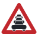
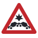
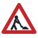
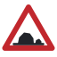
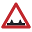
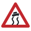

# Development ideas

Next pieces of work for Syria Organic Maps, to pick up soon.

## Next steps

- [ ] Deploy on Google Play and do more testing. Before submitting, to meet the Google Play policies:
  - [x] **Account deletion:** a "Delete account" action in Settings → Account, a backend endpoint that deletes
        the account and all its data, and a web page (or a privacy policy section) explaining how to request
        deletion, whose link goes in the Play Console.
        Done: `DELETE /me` (recorded as an `account_deleted` activity event without personal data) and the
        privacy policy section `https://organicmaps.openstreetmap.sy/privacy.html#delete-account`, which is the
        link for the Play Console once the website is deployed.
  - [x] **Consent before collecting data:** a short screen before signing in or the first upload that lists what
        is collected (recordings, live location, searches with their location, map download events) and why,
        links the privacy policy, and has "Agree" and "Not now" buttons.
        Done: `ConsentActivity`, shown before signing in and recording, and once per start to users signed in
        before it existed. Nothing is uploaded and live location stays off until "Agree"; the agreement is sent
        as a `consent` activity event.

## Ideas

### Road reports from users

Users send short reports about the road from the app while they are online. Each report carries its category,
the location (the current position, or a point picked on the map), the time and an optional note. Reports go to
the backend and show in the admin panel on a map and in a list, where the team can review and close them. Later,
recent reports could also show on the map for other users.

Categories:

- Traffic jam
- Closed road
- Accident

Suggested categories, for review:

- Road works
- Hazard on the road (debris, animals, a broken-down vehicle)
- Bad road surface (potholes, an unpaved stretch)
- Flooding, snow or ice
- Checkpoint
- Traffic light not working (for example during power cuts)
- Fuel available or not at a fuel station
- Map error (a missing or wrong road or place, a wrong name)
- Wrong route or turn instruction
- App problem or suggestion

Suggested icons, in the style of road signs (SVG files in `brand/road-reports/`, drawn by
`brand/road_report_icons.py`):

- **Report button on the map:** a yellow warning triangle with a thick charcoal border and rounded corners, and a
  black "!" inside, the "other danger" sign. A thin white edge keeps it visible on the dark map. The "!" is kept for
  this button only, so it stays recognisable. Its label: «أبلِغ» (Report).
- **Each category** uses the shape its sign has on the road, so the shape alone shows the kind of report:
  - a triangle with a red border is a warning;
  - a red circle, or a circle with a red ring, is a closure or restriction;
  - blue is information.
- Each icon also has its text label under it, and stays readable at small sizes, in the dark theme and for
  colour-blind users.

| Icon | Category | Arabic | Sign shape | Pictogram |
|---|---|---|---|---|
|  | Traffic jam | ازدحام مروري | Red-bordered triangle | Three cars seen from behind, queued one behind the other (the "traffic queues" sign) |
|  | Closed road | طريق مغلق | Red circle | A white bar (the "no entry" sign) |
|  | Accident | حادث | Red-bordered triangle | Two cars colliding, with a burst between them |
|  | Road works | أعمال على الطريق | Red-bordered triangle | A worker digging, and a pile of earth (the "roadworks" sign) |
|  | Hazard on the road | خطر على الطريق | Red-bordered triangle | Rocks lying on the road |
|  | Bad road surface | طريق متضرّر أو فيه حُفر | Red-bordered triangle | A road with two bumps (the "uneven road" sign) |
|  | Flooding, snow or ice | سيول أو ثلج أو جليد | Red-bordered triangle | A skidding car and its tracks (the "slippery road" sign) |
|  | Checkpoint | حاجز | Red-ringed circle | A barrier arm lowered across the road |
|  | Traffic light not working | إشارة مرور معطّلة | Red-bordered triangle | A traffic light with all three lights off |
|  | Fuel at a fuel station: available | يتوفّر وقود في المحطة | Blue square | A fuel pump with a green check |
|  | Fuel at a fuel station: none | لا يتوفّر وقود في المحطة | Blue square | A fuel pump with a red cross |
|  | Map error | خطأ في الخريطة | Blue square | A folded map and a pencil |
|  | Wrong route or turn instruction | مسار أو إرشاد انعطاف خاطئ | Blue circle (direction sign) | A turn arrow with a red cross |
|  | App problem or suggestion | مشكلة في التطبيق أو اقتراح | Blue square | A speech bubble with "i" |

### Payments to drivers by kilometres driven (admin panel)

A payments section in the admin panel that pays drivers for the kilometres they record:

- Set the rate per kilometre, and the period (for example monthly).
- Count only recordings from accounts signed in with a phone number, not anonymous ones.
- Leave out suspicious kilometres: impossible speeds or jumps, mock locations, duplicated recordings.
- Per driver and period: kilometres, amount due, and status (pending, approved, paid), with the date and a note
  for each payment.
- Export a period to CSV for the transfers. The transfers themselves happen outside the app.
- Drivers see their kilometres and payments in the app.

### North button on the map

Done: `NorthButton`, under the layers button in every map button layout (at the top of the start column while
navigating, where the layers button is hidden). Next to the zoom buttons it overlapped the traffic light in landscape. The renderer's compass is switched off on
the phone (`MapController.setCompassWidgetEnabled`), and the needle follows the map through
`Framework.nativeSetMapRotationListener`.

A map button that always shows where north is, and turns the map back to north-up with one tap:

- Today Organic Maps draws a small compass on the map only while the map is rotated, and in our app it ends up
  hidden behind the layers button, so users cannot see or tap it. First fix: move it so it never overlaps the
  layers button or our own buttons and badges (recording, live location). Its position is set in
  `MwmActivity.updateCompassOffset()`. Check it in portrait and landscape, in Arabic (RTL) and English, and while
  navigating.
- Then make it a button that stays visible next to the other map buttons, in the same style.
- Its arrow (a red "N" pointer) turns with the map, so it always points north.
- Tapping it turns the map back to north-up. While following your position, a second tap could switch to
  "direction of travel up", like in navigation.
- Label for screen readers: «الشمال» (North).

### iOS app

The Syria features are Android only (Kotlin in `android/app/.../syria/`). On iOS, only what comes from the shared
C++ core and map data already applies:

- maps from our server (`private.h`);
- the map download fixes (`libs/storage`);
- the map styles, and the Syria `countries.json` and country names.

Everything else needs porting to Swift. It needs a Mac with Xcode and an Apple developer account, and the iOS CI
check has to be turned back on (it was switched off in "[ci] Run only the Syria Android check").

Order to port, most important first:

1. **Basics:**
   - Arabic as the default language, and the Syria map downloaded on the first launch.
   - The Syria branding: app icon, launch screen and the map menu button.
   - The About page and the privacy policy link.
2. **Account and consent:**
   - Sign-in with phone number and PIN, or with Telegram.
   - The consent screen before data collection.
   - "Delete account" in the app, which the App Store requires too.
3. **Trip recording:**
   - Recording, offline sync, and the sync and connection status on the map.
   - Recording in the background needs iOS background location, a clear explanation in the location permission
     text, and a justification for App Store review.
4. **Live location**, with the auto-stop after 10 minutes without movement.
5. **Logging** of searches and map downloads and updates.
6. **Driving extras:**
   - The trip progress as a Live Activity (lock screen and Dynamic Island).
   - The "Drive safely" notice and the "Are you driving?" reminder.
   - A check that an Arabic voice is available for navigation.
7. **Share links:**
   - Share places with our `/l/` links.
   - Open them in the app with Universal Links (an `apple-app-site-association` file on the website, next to
     `assetlinks.json`).
   - An App Store button on the landing page for iPhones.
8. **Version history** in About. App updates come from the App Store, so the "new version" notice is not needed.

Before starting, check that the App Store is available in Syria. If it is not, TestFlight or the App Store in
other countries are the only ways to install, since iOS does not allow installing apps from a website.
